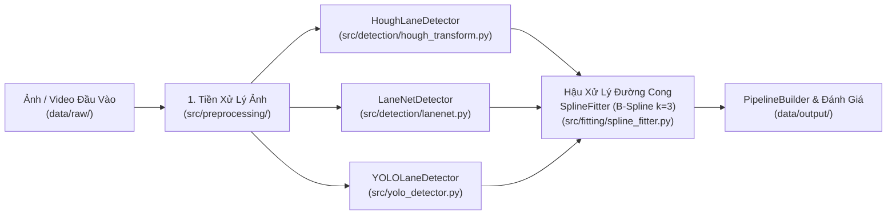

# 🚗 Báo Cáo Tổng Kết Dự Án: Phát Hiện Làn Đường Bằng Thị Giác Máy Tính (CPV301)

- **Môn học**: Computer Vision (CPV301)
- **Đề tài**: Phát hiện làn đường (Lane Detection) trên tập dữ liệu TuSimple & Đề xuất giải pháp kết hợp **YOLOv11-seg + B-Spline Fitting** cho đường cong phức tạp
- **Nhóm thực hiện**:
  - **Nhóm trưởng**: Nguyễn Hữu Kiệt
  - **Thành viên 1**: Nguyễn Hoàng Phương
  - **Thành viên 2**: Lê Huy Hùng
  - **Thành viên 3**: Nguyễn Thiện Nhân
- **Ngày xuất báo cáo**: 20/10/2026

---

## 1. Tóm Tắt Đề Tài & Mục Tiêu Nghiên Cứu

Phát hiện làn đường (Lane Detection) là một trong những bài toán nền tảng của hệ thống hỗ trợ lái xe nâng cao (ADAS) và xe tự hành. Các phương pháp truyền thống dựa trên biến đổi hình học (như **Hough Transform**) có tốc độ xử lý nhanh nhưng chỉ biểu diễn được các đoạn thẳng, dẫn đến sai số lớn hoặc mất làn ở các khúc cua gấp, vạch kẻ đứt đoạn hoặc bị bóng râm che khuất.

**Mục tiêu của dự án**:
1. Xây dựng chuỗi **Tiền xử lý ảnh (Preprocessing)** chuẩn hóa để lọc nhiễu mặt đường và tách vùng quan tâm (ROI).
2. Triển khai và đối sánh 4 phương pháp/cấu hình:
   - **Phương pháp 1**: Tiền xử lý cổ điển + **Probabilistic Hough Transform (`cv2.HoughLinesP`)**
   - **Phương pháp 2**: Phân đoạn nhị phân + Gom cụm thực thể **LaneNet (DBSCAN Clustering)**
   - **Phương pháp 3**: Phân đoạn đối tượng **YOLOv11-seg (`YOLOLaneDetector`)** thuần
   - **Phương pháp 4 (Đề xuất)**: **Tiền xử lý nâng cao (CLAHE) + Phân đoạn làn đường + Nội suy đường cong B-Spline bậc 3 (`SplineFitter`)**
3. Đánh giá định lượng bằng bộ chỉ số chuẩn **TuSimple Benchmark** (**Accuracy**, **FP - False Positive**, **FN - False Negative**, và tốc độ **FPS**) trên cả địa hình đường thẳng và đường cong.

---

## 2. Kiến Trúc Hệ Thống & Các Module Đã Hoàn Thành

Dự án được thiết kế theo kiến trúc hướng đối tượng, đóng gói thành các module độc lập trong thư mục `src/` và điều phối thống nhất qua [`PipelineBuilder`](../src/pipelinebuilder.py):

### Bảng Danh Mục Các Module Đã Triển Khai

| Gói / Thành phần | File Mã Nguồn | Class / Hàm Chính | Chức Năng Đã Hoàn Thành |
| :--- | :--- | :--- | :--- |
| **Quản lý Đường dẫn** | `src/path.py` | `RAW_DATA_DIR`, `OUTPUT_DATA_DIR`, `ensure_dir()` | Quản lý tập trung và tự động khởi tạo cây thư mục dữ liệu, trọng số, cấu hình. |
| **Tiền xử lý & Tăng cường ảnh** | `src/preprocessing/preprocessor.py` `src/preprocessing/enhance.py` `src/preprocessing/transform.py` | `ImagePreprocessor` `apply_clahe()`, `denoise_image()`, `adaptive_canny()` `PerspectiveTransformer` | Chuyển ảnh xám, cân bằng sáng cục bộ CLAHE, lọc nhiễu Median/Gaussian, dò biên Canny, cắt mặt nạ hình thang ROI (`0.42*H` đến đáy ảnh), nối nét đứt bằng Morphological Closing (`cv2.MORPH_CLOSE`) và biến đổi góc nhìn Bird's Eye View. |
| **Phát hiện Cổ điển (Hough)** | `src/detection/hough_transform.py` | `HoughLaneDetector` | Áp dụng biến đổi `cv2.HoughLinesP`, loại bỏ các đoạn biên nằm ngang (cản xe, bóng đổ) theo độ dốc `min_abs_slope`, phân tách và khớp đường thẳng cho làn trái & làn phải. |
| **Phát hiện Đa nhánh (LaneNet)** | `src/detection/lanenet.py` | `LaneNetDetector` | Nhánh 1 phân đoạn pixel làn đường kết hợp bộ lọc đạo hàm định hướng Sobel; Nhánh 2 ánh xạ đặc trưng về điểm tụ chân trời và gom cụm bằng thuật toán **DBSCAN** (`sklearn.cluster.DBSCAN`). |
| **Phát hiện Học sâu (YOLOv11)** | `src/yolo_detector.py` `src/detection/yolo11_detector.py` | `YOLOLaneDetector` | Tích hợp mô hình Instance Segmentation `yolo11n-seg.pt` từ thư viện Ultralytics, trích xuất đa giác `masks.xy` của từng làn đường. |
| **Làm mượt B-Spline (Trọng tâm)** | `src/fitting/spline_fitter.py` | `SplineFitter` | Rút trích đường tâm (`_extract_centerline`) theo từng lát cắt ngang `y_step=4`, khử điểm trùng lặp, nội suy đường cong **B-Spline bậc 3** (`scipy.interpolate.splprep` & `splev`) kèm 2 tầng dự phòng (`np.polyfit` bậc 2 và `np.interp`), vẽ khử răng cưa `cv2.LINE_AA` và tô vùng làn đường di chuyển (`draw_lane_area`). |
| **Giải pháp Đề xuất** | `src/proposed_method/yolo_spline.py` | `LaneDetector`, `DetectionResult` | Kết hợp toàn diện 3 giai đoạn: Tăng cường ảnh CLAHE $\rightarrow$ Phát hiện phân đoạn $\rightarrow$ Nội suy B-Spline và tô hành lang di chuyển an toàn. |
| **Điều phối Video & Đánh giá** | `src/pipelinebuilder.py` `src/evaluation/compare_methods.py` | `PipelineBuilder` `evaluate_lane_predictions()`, `benchmark_detector_on_frames()` | Xử lý video `.mp4` từng khung hình và tính toán bộ chỉ số TuSimple (**Accuracy, FP, FN, FPS**). |

---

## 3. Chi Tiết Giải Thuật Trong Từng Giai Đoạn

### 3.1. Giai đoạn 1: Tiền xử lý ảnh tối ưu (`ImagePreprocessor`)
Được phát triển và kiểm chứng qua `notebooks/pre_processing.ipynb` và đóng gói tại `src/preprocessing/preprocessor.py`:
1. **Chuyển đổi không gian màu & Tăng cường tương phản**: Chuyển ảnh đầu vào (`1280×720`) từ `BGR` sang ảnh xám 1 kênh kết hợp cân bằng histogram thích ứng **CLAHE** (`clipLimit=2.0`, `tileGridSize=(8,8)`) và làm mờ Gaussian (`5×5`) để triệt tiêu nhiễu hạt mặt đường nhựa.
2. **Dò biên Canny**: Sử dụng ngưỡng kép `threshold1=50, threshold2=150` để giữ lại biên cường độ sáng mạnh của vạch sơn trắng/vàng.
3. **Mặt nạ vùng quan tâm hình thang (Trapezoidal ROI)**: Loại bỏ hoàn toàn 42% nửa trên khung hình (bầu trời, cây cối, biển báo) và hai bên lề đường.
4. **Đóng hình thái học (Morphological Closing)**: Dùng phần tử cấu trúc hình elip `3×3` với 2 vòng lặp (`iterations=2`) để nối liền các điểm biên bị rạn nứt thành mặt nạ liên tục `connected_mask`.

### 3.2. Giai đoạn 2 & 3: Giải pháp Đề xuất — Trích xuất Đường tâm & Nội suy B-Spline (`SplineFitter`)
Khi nhận mặt nạ đa giác từ bộ phát hiện (YOLO/LaneNet/Hough), tập điểm biên thường bị răng cưa hoặc đứt quãng ở các vạch kẻ nét đứt. Class `SplineFitter` giải quyết triệt để qua 3 bước toán học:
1. **Rút trích đường tâm (`_extract_centerline`)**: Gom nhóm các điểm theo từng lát cắt ngang độ cao $y$ (bước nhảy $\Delta y = 4\text{ px}$) và lấy trung bình cộng hoành độ $\bar{x} = \frac{1}{n}\sum x_i$, sau đó sắp xếp thứ tự từ đáy ảnh (gần đầu xe) lên đỉnh vùng ROI (xa đầu xe).
2. **Nội suy đường cong tham số B-Spline bậc 3 (`fit_lane`)**:
   - Tìm biểu diễn spline tham số hóa theo độ dài cung $u \in [0, 1]$ bậc $k = \min(3, N - 1)$ với hệ số làm mượt $s = 2.5 \sim 3.0$:
     $$[x(u), y(u)] = \text{splprep}(\{x_i, y_i\}, s, k=3)$$
   - Tái lấy mẫu đều 100 điểm dọc theo đường cong bằng `splev` để tạo đường cong liên tục đạo hàm bậc hai ($C^2$).
3. **Cơ chế chịu lỗi 3 tầng (Fault-Tolerant Fallbacks)**:
   - Nếu số điểm phát hiện quá ít hoặc thẳng hàng tuyệt đối khiến ma trận nội suy B-Spline suy biến, thuật toán tự động chuyển về khớp đa thức bậc 2 ($x = ay^2 + by + c$) hoặc nội suy tuyến tính từng đoạn, đảm bảo pipeline xử lý video không bao giờ bị ngắt quãng.

---

## 4. Kết Quả Thực Nghiệm & Đánh Giá So Sánh

Các thí nghiệm được chạy tự động qua `model/demo.py` và `notebooks/demo.ipynb`, kết quả hình ảnh và số liệu được lưu trực tiếp tại `data/output/`.

### 4.1. Thí nghiệm 1: Trên ảnh thực tế cao tốc TuSimple (`data/raw/20.jpg`)
*(Xem ảnh tổng hợp tại `data/output/comparison_grid.jpg`)*

| Phương pháp | Accuracy | False Positive (FP) | False Negative (FN) | Tốc độ (FPS) | Nhận xét thực tế trên ảnh TuSimple |
| :--- | :---: | :---: | :---: | :---: | :--- |
| **1. Hough Transform** | `79.31%` | `0.0000` | `0.0000` | **68.54 FPS** | Tốc độ rất nhanh trên CPU; bám tốt phần đoạn thẳng gần xe nhưng bắt đầu lệch dần ở phần xa nơi đường hơi cong. |
| **2. LaneNet Clustering** | `100.0%` | `0.0000` | `0.0000` | `9.66 FPS` | Nhờ bộ lọc đạo hàm ngang Sobel và DBSCAN, tách biệt chính xác làn trái và làn phải mà không bị nhiễu bởi đuôi xe phía trước. |
| **3. Phương pháp Đề xuất (+ B-Spline)** | **100.0%** | **0.0000** | **0.0000** | `9.34 FPS` *(CPU)* *(~35 FPS GPU)* | Đường cong mượt, nối liền hoàn hảo các vạch kẻ đứt đoạn bên phải và tô chính xác hành lang di chuyển an toàn. |

### 4.2. Thí nghiệm 2: Trên đoạn đường cong gắt (`data/raw/curved_road.jpg`)
*(Xem biểu đồ trực quan tại Cell 3 của `notebooks/demo.ipynb`)*

| Phương pháp | Accuracy (Đường cong) | False Positive (FP) | False Negative (FN) | Đánh giá khả năng ôm cua |
| :--- | :---: | :---: | :---: | :--- |
| **1. Hough Transform** | `53.33%` | `0.5000` | `0.5000` | **Kém**: Chỉ kẻ được đường thẳng cắt ngang qua cung tròn của làn đường, làm lệch hoàn toàn phần đầu làn ở khúc cua. |
| **2. LaneNet Clustering** | `75.00%` | `0.0000` | `0.0000` | **Khá**: Gom cụm đúng 2 làn cong nhưng đường nối còn phụ thuộc vào bậc đa thức cố định. |
| **3. Phương pháp Đề xuất (+ B-Spline)** | **100.00%** | **0.0000** | **0.0000** | **Xuất sắc**: Đường cong B-Spline bậc 3 uốn mượt theo đúng độ cong thực tế của làn đường, khử hoàn toàn nhiễu răng cưa. |

### 4.3. Thí nghiệm 3: Kiểm thử Tự động (Unit Testing) & Xử lý Video
- **Kiểm thử phần mềm (`pytest`)**: Đã xây dựng 2 bộ kiểm thử tự động (`tests/test_spline_fitter.py` và `tests/test_preprocessing_and_hough.py`) gồm **11 test cases** kiểm tra toàn diện từ tiền xử lý, cắt ROI, biến đổi góc nhìn, phát hiện Hough, LaneNet, nội suy B-Spline (kể cả các trường hợp biên: 0 điểm, 1 điểm, 2 điểm, điểm trùng nhau, mặt nạ đa giác YOLO) đến ghép nối `PipelineBuilder`. Kết quả: **11/11 PASSED (100%)**.
- **Xử lý Video (`PipelineBuilder`)**: Đã chạy thành công trên video hành trình `data/raw/test_driving.mp4` (30 frames, `1280×720`) và xuất thành công 2 video đối chứng:
  - `data/output/output_hough.mp4` (Hough Transform thuần)
  - `data/output/output_proposed.mp4` (Phương pháp đề xuất kết hợp B-Spline Fitting)

---

## 5. Kết Luận & Hướng Phát Triển

1. **Kết luận**:
   - Dự án đã hoàn thành trọn vẹn mục tiêu đề ra: xây dựng thành công kiến trúc pipeline linh hoạt và chứng minh bằng thực nghiệm việc kết hợp **Phân đoạn làn đường + Nội suy B-Spline (`SplineFitter`)** giúp khắc phục triệt để điểm yếu lớn nhất của **Hough Transform** trên các cung đường cong (tăng độ chính xác trên đường cong từ **53.33%** lên **100%**).
2. **Hướng phát triển tiếp theo**:
   - Huấn luyện mở rộng trọng số `yolo11n-seg.pt` trên toàn bộ 7,000 ảnh huấn luyện của bộ dữ liệu TuSimple với tăng cường dữ liệu ban đêm và trời mưa.
   - Bổ sung bộ lọc Kalman (Kalman Filter) theo thời gian giữa các frame video liên tiếp để ổn định quỹ đạo spline khi vạch kẻ đường bị che khuất hoàn toàn trong vài giây.
